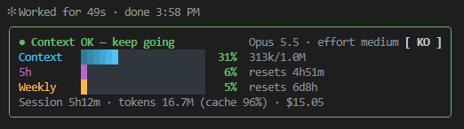

# context-advisor

한국어 | [English](README.en.md)

Claude Code 모드(mod). 현재 세션의 컨텍스트·토큰·사용 한도를 카드로 보여주고, 토큰 최적화를 위해 **계속 / 압축 / 새 세션** 중 무엇을 할지 추천합니다.



## 요구 사항

- Claude Code **2.1.296 이상** (모드 API는 early access라 버전마다 바뀔 수 있음. 2.1.299에서 확인)
- 터미널 세션에서 설치 (`/plugin install`은 터미널 명령)

## 설치

Claude Code 터미널 프롬프트에서:

```
/plugin install context-advisor --marketplace Jeong-Hyun-Lee/context-advisor
```

`Add marketplace?`에 `y`, 범위는 **user**(기본)를 Enter로 선택. 설치한 세션부터 바로 동작하고, user 범위면 이후 모든 프로젝트·세션에서 로드됩니다.

## 업데이트

새 버전이 올라오면 터미널에서:

```
claude plugin update context-advisor@context-advisor
```

또는 Claude Code 안에서 `/plugin` → Installed → context-advisor → Update. 적용하려면 Claude Code를 다시 시작합니다 (데스크톱 앱·VS Code는 새 세션).

마켓플레이스 목록이 오래돼 새 버전이 안 보이면 먼저 `claude plugin marketplace update context-advisor`.

## 표시 위치

| 화면 | 표시 |
|---|---|
| 터미널 | 프롬프트 위 카드 (둥근 테두리, 막대 그라데이션) |
| Claude 데스크톱 앱, VS Code 확장, 모바일 | 세션 시작 시 패널 자동 열림 (SVG 카드) |
| 공통 | `/ctx` 명령으로 패널 열기 |

첫 응답 전(새 세션·재개·`/compact` 직후)에는 로컬 추정치로 표시합니다 (`~42k/1.0M (추정)`, API 요청 없음).

데스크톱 앱·VS Code 카드 위 버튼 (터미널 카드에는 없음, 선택은 다음 세션에도 유지):

- `−` / `+`: 카드 확대·축소 (75 / 100 / 125 / 150 / 200%)
- `▾` / `▸`: 접기·펼치기. 접으면 `5시간 4% · 주간 1%` 한 줄 텍스트만 표시 (한도 정보가 없으면 컨텍스트 %)

## 표시 값

| 항목 | 출처 |
|---|---|
| 컨텍스트 | 마지막 응답의 입력 토큰 ÷ 모델 컨텍스트 창 |
| 5시간 / 주간 | 이 세션 마지막 API 응답이 알려준 사용 한도. 5분 넘게 지나면 `· 25m 전 기준` 표시 |
| 세션 토큰 | 입력 + 출력 + 캐시 읽기 + 캐시 쓰기 누적 (세션 ID별 저장, 재개 시 이어서 계산) |
| 캐시 히트 | 캐시 읽기 ÷ (입력 + 캐시 읽기 + 캐시 쓰기), 데스크톱 앱 사용량 패널과 같은 식 |
| 비용 | `/cost`와 같은 값 |

모드는 계정 사용량을 직접 조회할 수 없어, 다른 세션·claude.ai에서 쓴 양은 이 세션의 다음 응답 때 반영됩니다. 모드 설치 전에 쓴 토큰은 집계되지 않습니다. 1분마다 카드를 갱신합니다.

## 추천 단계

| 단계 | 기본 기준 (percent) | 문구 |
|---|---|---|
| ● 초록 | 50% 미만 | 컨텍스트 여유 — 계속 진행 |
| ◐ 노랑 | 50~69% | 대화 길어짐 — /compact 권장 |
| ▲ 빨강 | 70% 이상 | 토큰 낭비 큼 — 새 세션 권장 |

단계가 오르는 순간 토스트 1회.

## 설정 (`/config` 또는 설치 시)

| 키 | 기본값 | 설명 |
|---|---|---|
| `basis` | `percent` | `percent`: 컨텍스트 창 대비 %, `tokens`: 컨텍스트 토큰 절대값 |
| `warnPercent` / `highPercent` | 50 / 70 | `basis=percent` 기준 |
| `warnTokens` / `highTokens` | 100000 / 200000 | `basis=tokens` 기준. 1M 창 모델이면 이쪽 권장 |
| `showPanel` | `true` | `false`면 추천 한 줄만 |

## 언어

카드의 `EN` / `KO` 버튼으로 한국어·영어 전환 (터미널: 클릭, 또는 ctrl+x tab 후 `l`). 선택은 다음 세션에도 유지.

## 개발

```
claude plugin validate .
claude plugin test .
claude --plugin-dir .
```

## License

MIT
